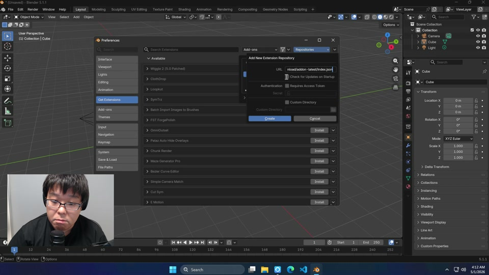

# 🛠️ Install

Install the add-on in Blender, then point it at a solver. This page covers
the add-on; [Connections](../connections/index.md) covers the solver.

## Prerequisites

- **Blender 5.0 or newer.**
- **A solver.** The add-on is a client and does not include the solver. You
  download or build it separately:
  1. Download a self-contained distribution from
     [GitHub Releases](https://github.com/st-tech/ppf-contact-solver/releases)
     and unzip it, or build the engine from
     [st-tech/ppf-contact-solver](https://github.com/st-tech/ppf-contact-solver).
  2. For a native connection (**Windows Native**, **macOS Native**, or
     **Linux Native**), which runs the solver on the machine Blender runs on,
     set **Solver Path** to the unzipped folder. For SSH and Docker
     connections the solver runs on the SSH host or in the container
     instead. See [Connections](../connections/index.md) for which type fits.

  Which build the solver runs depends on the hardware:

  | Hardware | Build | Platforms |
  | -------- | ----- | --------- |
  | NVIDIA GPU | CUDA 12.8+ | Linux (x86_64, arm64), Windows (x64) |
  | AMD GPU | ROCm | Linux (x86_64), Windows (x64) |
  | Apple silicon | Metal | macOS |
  | Any CPU | CPU | macOS, Windows, Linux |

  The CPU build needs no GPU and is substantially slower than the others.
  The x64 Windows and x86_64 Linux distributions contain the CUDA, ROCm, and
  CPU builds together, and you pick between them in the panel; see
  {ref}`Choosing the Build <choosing-the-build>`. To check which build a
  binary is, run `ppf-contact-solver --backend`; it prints `cuda`, `rocm`,
  `metal`, or `cpu`. The ROCm build has not been run on real AMD hardware.
- **A supported platform.** The add-on runs on Apple-silicon macOS, x86-64
  and arm64 Linux, and x64 and arm64 Windows. It needs no GPU on the Blender
  machine. A native connection runs the solver on that machine and needs the
  solver folder there, while an SSH or Docker connection runs the solver
  elsewhere.
- **Internet access on the Blender machine**, for Option A below and for the
  module install buttons described in the next two items. Option B installs
  from a file you have already downloaded.
- **(Optional) paramiko and docker-py.** Needed only for some connection
  types. When a type needs one that is missing, the **Backend Communicator**
  panel shows an **Install Paramiko to Add-on Directory** button (the **SSH**,
  **SSH Command**, **Docker over SSH**, and **Docker over SSH Command**
  types) or an **Install Docker-Py to Add-on Directory** button (the
  **Docker** type). Click it once; the module is installed into Blender's
  user `scripts/addons/modules` directory.
- **cbor2 (bundled).** Every **Transfer** encodes the scene with cbor2. The
  extension includes it, so there is normally nothing to do. If it is missing
  (for example after copying the add-on folder by hand), the **Solver** panel
  shows *cbor2 is missing; Transfer and Run cannot encode*, and an **Install
  cbor2 to Add-on Directory** button appears at the top of the **Backend
  Communicator** panel. Click it to install cbor2 into the same
  `scripts/addons/modules` directory.

:::{note}
The add-on only looks for `ppf-cts-server` (`ppf-cts-server.exe` on Windows
Native) under the path you give it, in the build layouts listed in
{ref}`Choosing the Build <choosing-the-build>`.
:::

## Install the Add-on

Blender installs the add-on as an extension. Option A is recommended because
Blender lists each new release and upgrades with one click. Option B works
without internet access, and Option C is for people working from a source
checkout.

### Option A: Add as a Remote Repository (recommended)

When a new add-on release is published, Blender's **Get Extensions** panel
lists it, and one click upgrades.

1. In Blender, open **Edit > Preferences > Get Extensions**.
2. Click **Repositories** at the top right of the panel, click the **+**
   button, and choose **Add Remote Repository**.
3. Paste this URL into the **URL** field and click **Create**:

   ```
   https://github.com/st-tech/ppf-contact-solver/releases/download/addon-latest/index.json
   ```

4. Make sure the new repository is enabled, then search **Get Extensions**
   for `ZOZO`. **ZOZO's Contact Solver** appears; click **Install**.
5. Open the 3D Viewport sidebar (<kbd>N</kbd>). A tab labeled **ZOZO's Contact
   Solver** appears.

The URL does not change between releases, so Blender finds new versions
without any further setup.

### Option B: Install from a Downloaded Zip

Use this when the Blender machine has no internet access, or when you want a
specific release. The zip includes everything the add-on needs, cbor2
included.

1. On [GitHub Releases](https://github.com/st-tech/ppf-contact-solver/releases),
   open a dated add-on release (tag `addon-YYYY-MM-DD-HHMM`, titled *Blender
   Add-on* followed by the version) and download its **Blender Extension Zip**
   (`ppf_contact_solver_<date>.zip`).
2. In Blender, open **Edit > Preferences > Get Extensions**.
3. Open the dropdown menu at the top right of the panel and pick **Install from
   Disk...**, then choose the zip.
4. Open the 3D Viewport sidebar (<kbd>N</kbd>) and look for the **ZOZO's
   Contact Solver** tab.

An add-on installed this way does not update itself. Repeat the steps with a
newer zip to upgrade.

### If the Sidebar Tab Does Not Appear

Confirm that the extension is enabled in **Edit > Preferences > Add-ons**. If it
is enabled and the tab is still missing, re-enable it and read the error in
Blender's console. On Windows, open **Window > Toggle System Console**. On macOS
and Linux, start Blender from a terminal. See
[Troubleshooting](../troubleshooting.md#installation) for common install
problems.

### Option C: Install from a Source Checkout (for Contributors)

Use this when you work from a checkout of the repository or want a build that
has no release yet. The script links the checkout's `blender_addon/` folder
into Blender, so edits in the checkout show up after a Blender restart, with
no re-zipping.

The first run needs `python3` (or `python`) on your `PATH` and internet
access, because the script downloads the cbor2 files the add-on needs.
Later runs work offline.

1. Clone the repository and `cd` into it.
2. Run the script for your platform from the repository root.

   On macOS or Linux:

   ```bash
   ./install-blender-addon.sh
   ```

   On Windows PowerShell:

   ```powershell
   .\install-blender-addon.ps1
   ```

   The script detects your installed Blender version. On a machine where
   Blender has never been launched, point it at the Blender binary so it can
   create the preferences folder itself:

   ```bash
   PPF_BLENDER_BIN=/path/to/blender ./install-blender-addon.sh
   ```

   ```powershell
   $env:PPF_BLENDER_BIN = "C:\Program Files\Blender Foundation\Blender 5.0\blender.exe"
   .\install-blender-addon.ps1
   ```

3. Start Blender and enable **ZOZO's Contact Solver** under
   **Edit > Preferences > Add-ons** (search for `ZOZO`), or pass
   `--addons bl_ext.user_default.ppf_contact_solver` on the command line.
4. Check for the sidebar tab, as in Option A.

To remove the link later, run the script with the uninstall flag:

```bash
./install-blender-addon.sh --uninstall
```

```powershell
.\install-blender-addon.ps1 -Uninstall
```

The uninstall also lists the packages in Blender's user `scripts/addons/modules`
folder, where the paramiko, docker-py, and cbor2 install buttons put them, and
asks whether to delete them. The default is to keep them, and without an
interactive terminal the script leaves them in place.

:::{admonition} Under the hood
:class: toggle

The cbor2 files the script downloads are named in `blender_manifest.toml` and
are not part of a fresh clone. Blender enables an extension even when files its
manifest names are missing, and the add-on would then fail at the first
**Transfer**, so the script stops instead of linking an incomplete add-on. Once
the files are on disk the download is skipped.

If no `python3` or `python` is on `PATH`, set `PPF_PYTHON_BIN` to a Python
interpreter (`PPF_BUILD_PYTHON` on Windows) before running the script.
:::

## Video Walkthroughs

<figure style="text-align: center; margin: 1.5rem 0;">

[](https://zozo.box.com/s/jhs75ddc3oihrl4bw4fa00hpi2dsjdrs){target="_blank" rel="noopener"}

<figcaption>Windows Setup: an end-to-end install walkthrough on Windows.</figcaption>
</figure>

<figure style="text-align: center; margin: 1.5rem 0;">

[](https://www.youtube.com/watch?v=D0k6evTvJDg){target="_blank" rel="noopener"}

<figcaption>Video tutorial by <a href="https://www.youtube.com/@CGMatter" target="_blank" rel="noopener">CGMatter</a>: a full setup and workflow walkthrough.</figcaption>
</figure>

More recordings are on the [Video Tutorials](../tutorial.md) page.
